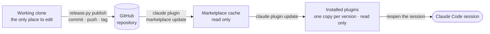

# research-plugins

English | [한국어](README.ko.md)

Plugins for academic writing and PDF literature search, shared by Claude Code and Codex.
They are versioned in this one repository so that **every computer and every account runs the same version**.

| Item | Value |
|---|---|
| Marketplace name | `research-plugins` |
| Repository | `sky-born/research-plugins` |
| Plugins | `research-writing` · `paper-index` |
| Updates | Manual — see [Updating](#updating) |
| Editing this repository | [`CLAUDE.md`](CLAUDE.md) (in Korean) — which clone to edit, the release steps |

**Jump to** — [Plugins](#plugins) · [Installing](#installing) · [Updating](#updating) · [Repository layout](#repository-layout) · [Changing and releasing](#changing-and-releasing) · [Adding a plugin](#adding-a-plugin) · [Credentials for the private repository](#credentials-for-the-private-repository) · [Troubleshooting](#troubleshooting)

---

## Plugins

| Plugin | Skill | What it does | Call in Claude Code |
|---|---|---|---|
| `research-writing` | `manuscript` | Entry point of a manuscript session — works out which manuscript project the open folder is | `/research-writing:manuscript` |
| | `manuscript-workflow` | Shared writing rules — style, evidence grades, citations, the revision protocol, open-item tracking | `/research-writing:manuscript-workflow` |
| | `new-manuscript` | Creates a new manuscript project with its tools, settings and tracker files in one go | `/research-writing:new-manuscript` |
| `paper-index` | `paper-search` | Indexes a PDF library, searches the full text, and matches Scopus results against the papers you own | `/paper-index:paper-search` |

In Codex, pick the skill of the same name in the skill picker.
The skill instructions and the names of the tools copied into a project are in Korean.
The call syntax differs per app, but **both apps read the same instructions and run the same tools** ([One source, two registrations](#one-source-two-registrations)).

---

## Installing

Do this once per computer and account. While the repository is private, [credentials](#credentials-for-the-private-repository) must be in place first.
Claude Code and Codex use the same command — the script finds the apps on the computer and registers and installs for each.

**Windows (PowerShell)**

```powershell
git clone https://github.com/sky-born/research-plugins "$env:USERPROFILE\dev\research-plugins"
python "$env:USERPROFILE\dev\research-plugins\bootstrap\bootstrap.py" install
```

**macOS · Linux**

```bash
git clone https://github.com/sky-born/research-plugins ~/dev/research-plugins
python3 ~/dev/research-plugins/bootstrap/bootstrap.py install
```

Reopen the app's session when it finishes. The folder you cloned is also the **working clone** used to edit this repository ([Three clones](#three-clones)).

| Option | Meaning |
|---|---|
| `--app claude` · `--app codex` · `--app all` | One app only, or both (fails if either is missing). Omit it to use every app found on the computer |
| `--dry-run` | Print the commands without running them |
| `--claude <path>` | Point at the `claude` executable directly |
| `--codex <path>` | Point at the `codex` executable directly |
| `--ref <tag or commit>` | Codex only — pin a release tag or commit instead of the default `main` |
| `--local` | Codex only, for testing before a release — register this working clone instead of GitHub (the folder is not moved) |

> [!WARNING]
> On Windows use PowerShell, not Git Bash.
> On some computers Git Bash's `$HOME` is not the user profile, so `~/dev` and `~/.claude` resolve to the wrong place.
> If you must handle paths in Git Bash, use `$USERPROFILE` ([`CLAUDE.md`](CLAUDE.md) §3).

<details>
<summary>What the bootstrap does</summary>

1. Finds the app's executable. For `claude` the order is `--claude` → the `CLAUDE_CODE_EXECPATH` environment variable (set inside a session) → PATH → the copy bundled with the desktop app; for `codex` it is `--codex` → PATH → the copy bundled with the Codex desktop app (on Windows under `%LOCALAPPDATA%`; on macOS an app in `/Applications` or `~/Applications`).
2. Reads the marketplace name and plugin list from `.claude-plugin/marketplace.json` and the repository address from the working clone's `git remote`.
3. Checks that the repository can be read **without a login prompt**. If not, it stops here and says how to fix it.
4. Runs `claude plugin marketplace add` if the marketplace is not registered, or `claude plugin marketplace update` if it is.
5. For each plugin, runs `claude plugin install` if it is missing, or `claude plugin update` if it is present.
6. Prints the installed versions next to the versions in the working clone.

No settings file is edited directly. The commands in steps 4 and 5 write these two keys to the user settings `.claude/settings.json`.

```json
{
  "extraKnownMarketplaces": {
    "research-plugins": {
      "source": { "source": "github", "repo": "sky-born/research-plugins" }
    }
  },
  "enabledPlugins": {
    "paper-index@research-plugins": true,
    "research-writing@research-plugins": true
  }
}
```

Both keys go into the user settings, so they **apply to every project**.
For Codex the script only calls Codex's own marketplace and plugin commands.

</details>

<details>
<summary>Manually, without the bootstrap</summary>

```text
/plugin marketplace add sky-born/research-plugins
/plugin install paper-index@research-plugins
/plugin install research-writing@research-plugins
```

</details>

> [!NOTE]
> For a private repository Codex needs **local Git authentication**. Connecting GitHub in ChatGPT does not create it.

<details>
<summary>Codex — going back from a local test registration to GitHub</summary>

Codex does not overwrite a marketplace's source when one of the same name is registered again. Run these two commands in order.

```text
codex plugin marketplace remove research-plugins
python bootstrap/bootstrap.py install --app codex
```

</details>

---

## Updating

> [!IMPORTANT]
> **Updates are not automatic.** After a new version is released, run the commands below on each computer that should get it, then **reopen the session.**

Run them in the working clone. Both apps need only these two lines.

```text
git pull
python bootstrap/bootstrap.py update
```

Use whichever Python launcher that computer has, `python` or `python3`.
`python bootstrap/bootstrap.py status` shows what is registered and installed right now.

<details>
<summary>Directly, without the script</summary>

```bash
claude plugin marketplace update research-plugins
claude plugin update research-writing@research-plugins
claude plugin update paper-index@research-plugins
```

- `update` is only needed for the plugins that changed.
- **It is `update`, not `install`.** Running `install` on a plugin that is already installed only prints `already installed` and leaves the version as it is.
- For Codex it is `codex plugin marketplace upgrade research-plugins`, then `codex plugin add <plugin>@research-plugins` for each plugin.

</details>

<details>
<summary>Why updates do not arrive on their own</summary>

There are two causes, and this repository can change neither.

- **Auto-update is off by default for a personal marketplace.** Unless a marketplace is an official one, it stays off until `autoUpdate` is turned on.
- **The desktop app passes `DISABLE_AUTOUPDATER` to the CLI process.** With that value set, the plugin auto-update step is skipped entirely.

Automating this was deliberately left out. Turning it on needs both `autoUpdate: true` and the `FORCE_AUTOUPDATE_PLUGINS` environment variable,
and the latter works against a value the desktop app sets, so it would have to be re-checked whenever the app changes. Running the commands above when needed costs less to maintain.

</details>

---

## Repository layout

```
research-plugins/
├── README.md                        Install and usage (this file)
├── README.ko.md                     The same content in Korean
├── CLAUDE.md                        Working rules for editing this repository (Korean)
├── AGENTS.md                        Entry note for Codex (points to CLAUDE.md)
├── CHANGELOG.md                     Release history per plugin
├── LICENSE                          MIT
├── .github/workflows/
│   └── check.yml                    Runs `release.py check` on Windows, macOS and Linux on every push
├── .claude-plugin/
│   └── marketplace.json             Marketplace definition — the source of the plugin list
├── .agents/plugins/
│   └── marketplace.json             Registration file for Codex (generated)
├── bootstrap/
│   └── bootstrap.py                 Register, install, update, status for both apps (install · update · status)
├── scripts/
│   ├── release.py                   Check, try out, version bump, release (check · try · bump · publish)
│   ├── cli_common.py                Helpers shared by the two scripts above
│   ├── sync_codex_manifests.py      Writes everything derived from plugin.json; reports drift
│   ├── validate_shared_plugins.py   Validates the layout both apps share
│   ├── tool_hashes.py               Builds the hash list of managed files
│   ├── check_public.py              Looks for personal information in what would be published
│   └── preview_projects.py          Applies new tools to a copy of a real project
├── tests/                           Pre-release tests (unittest)
└── plugins/
    ├── research-writing/
    │   ├── .claude-plugin/plugin.json   Source of name, version and description
    │   ├── .codex-plugin/plugin.json    For Codex (generated)
    │   ├── README.md
    │   ├── hooks/hooks.json             Hooks that protect shared files in a manuscript project
    │   └── skills/
    │       ├── manuscript/              SKILL.md
    │       ├── manuscript-workflow/     SKILL.md · references/ · templates/
    │       └── new-manuscript/          SKILL.md · init_manuscript.py · update_tools.py · tools/ · hooks/
    └── paper-index/
        ├── .claude-plugin/plugin.json
        ├── .codex-plugin/plugin.json    For Codex (generated)
        ├── README.md
        └── skills/paper-search/         SKILL.md · papertool.py · lib/ · presets/ · references/ · templates/
```

### Three clones

One computer ends up with three copies of this repository. **Only the working clone may be edited.**



| Clone | What it is | How to treat it |
|---|---|---|
| **Working clone** | Made by you with `git clone` | **Edit only here** |
| Marketplace cache | Made by `claude plugin marketplace add` | Read only — `marketplace update` overwrites it |
| Installed plugins | Per-version copies unpacked by `claude plugin install` | Read only — look here to see which version is installed |

The actual paths differ per computer and are not recorded in this repository. `python bootstrap/bootstrap.py status` shows this computer's state ([`CLAUDE.md`](CLAUDE.md) §3).

### One source, two registrations

The instructions, reference documents and tools under `plugins/<plugin>/skills/` are **the same source for both apps**.
Skill content is not copied into separate Claude and Codex versions.

| | Claude Code | Codex |
|---|---|---|
| Marketplace | `.claude-plugin/marketplace.json` | `.agents/plugins/marketplace.json` (generated) |
| Plugin registration | `.claude-plugin/plugin.json` | `.codex-plugin/plugin.json` (generated) |
| Skills and tools | `plugins/<name>/skills/` | The same folder |
| Source of the version | `version` in `.claude-plugin/plugin.json` | Generated from the source and checked against it |

A plugin's name, version, description, author, license and keywords are written in one place, `plugin.json`.
The Codex files and the same fields of the plugin's entry in `.claude-plugin/marketplace.json` are generated from it.
Generated files are not edited by hand.

```text
python scripts/sync_codex_manifests.py            # regenerate the derived files
python scripts/sync_codex_manifests.py --check    # only report drift
python scripts/validate_shared_plugins.py         # validate the shared layout
```

---

## Changing and releasing

> [!WARNING]
> **Keep the working clone outside cloud-sync folders (Google Drive, OneDrive).**
> Sync can half-overwrite `.git` and break the repository. Clone separately on each computer and let GitHub do the syncing.

### Version rule

> [!IMPORTANT]
> **When you change a plugin, raise the `version` in that plugin's `.claude-plugin/plugin.json`.**
> That value is the release version, and other computers see a new version only when it changes. If you change files and leave the version alone, other computers keep using the old one.

- Plugins in this repository are served by relative path (`./plugins/...`), and the version is fixed by the value written in `plugin.json`.
- Plugin entries in `marketplace.json` carry no `version`. If both places have one, Claude Code silently uses the one in `plugin.json`. Keep it in one place.
- `scripts/release.py` checks this rule and stops when the version was not raised.

### Steps

Run these in the working clone. The commands are the same on Windows, macOS and Linux.

```text
git pull

# 1) edit files
# 2) raise the version - plugin.json, derived files and the hash list in one go
python scripts/release.py bump <plugin> patch

# 3) add "### <version> - <date>" and what changed under that plugin in CHANGELOG.md

# 4) check first
python scripts/release.py check
python scripts/release.py try <folder>

# 5) release
python scripts/release.py publish -m "paper-index v0.10.0: short summary"
```

After releasing, run the commands in [Updating](#updating) on each computer.
The one validation `check` does not run is the preview on a copy of a real project (`preview_projects.py`); it is described in [`CLAUDE.md`](CLAUDE.md) §1.

What `check` does, in order:

1. Runs `git fetch` on the baseline's remote and confirms the baseline `origin/main`, and that every file name is ASCII — otherwise it **stops**
2. Looks for personal information in the files, their paths, the commits to push and the identity of the next commit (`check_public.py`) — anything found **stops** it. Personal terms come from a deny list kept outside the repository (`--deny-list`, `RESEARCH_PLUGINS_DENYLIST`, or `git config research-plugins.denylist <file>` in the clone); without one only the generic patterns run, with a warning
3. Validates the layout both apps share and that derived files match their source (`validate_shared_plugins.py`), and that the hash list of managed files is current (`tool_hashes.py --check`)
4. Validates the marketplace and plugin manifests with `claude plugin validate` — it prints which executable and version it used
5. Compares with the baseline to find the **plugins that changed**, and confirms each one's `version` was raised — otherwise it **stops**
6. Confirms `CHANGELOG.md` has an entry for each raised version — otherwise it **stops**
7. Runs all tests (`tests/`)

Every push also runs the same `check` on Windows, macOS and Linux through GitHub Actions (`.github/workflows/check.yml`), without the `claude plugin validate` step.

`publish` passes the same checks, then commits → `git push` → creates and pushes a `{name}--v{version}` tag per plugin.
A tag goes on the last commit that changed that plugin's folder.

| Option | Meaning |
|---|---|
| `-m "..."` | Commit subject (up to 72 characters). Repeat it for body paragraphs. Without it the subject is built from the changed plugins and versions |
| `--no-push` | Commit and tag only (`publish`) |
| `--no-tag` | Do not create tags (`publish`) |
| `--skip-tests` | Do not run the tests — the output says they were not run |
| `--skip-claude` | Do not run `claude plugin validate` — for the GitHub Actions run, where `claude` is not installed |
| `--claude <path>` | Point at the `claude` executable directly |
| `--baseline <ref>` | What to compare against (default `origin/main`) |

---

## Adding a plugin

```
plugins/<name>/
├── .claude-plugin/plugin.json      name · version · description · author · license
└── skills/<skill-name>/SKILL.md
```

`commands/`, `agents/` and `hooks/` can sit at the same level. After creating it, do these three things.

1. Add an entry to the `plugins` array in `.claude-plugin/marketplace.json`

   ```json
   {
     "name": "<name>",
     "source": "./plugins/<name>",
     "category": "research",
     "strict": true
   }
   ```

2. Run `python scripts/sync_codex_manifests.py` — it writes the Codex registration files and fills the description, author, license and keywords of the entry above from `plugin.json`
3. Add a `## <name>` section with the first version's entry to `CHANGELOG.md`, then release with `python scripts/release.py publish`

The install script reads the plugin list from `marketplace.json`, so nothing else needs editing.

**When a plugin is renamed or removed**, record it under `renames` in `marketplace.json`.
An old name in another computer's settings is then moved to the new one. Entries in this table are kept, not deleted.

```json
"renames": { "old-name": "new-name", "removed-name": null }
```

---

## Credentials for the private repository

A private repository needs **GitHub credentials stored on each computer and account**. Without them the update commands fail. A public repository needs none.

```bash
GIT_TERMINAL_PROMPT=0 git ls-remote https://github.com/sky-born/research-plugins HEAD
```

If that succeeds, you are set. If it fails, fix it one of two ways.

- **Windows** — run `git clone https://github.com/sky-born/research-plugins` once and sign in at the Git Credential Manager prompt.
- **With the `gh` CLI** — `gh auth login`, then `gh auth setup-git`

---

## Troubleshooting

| Symptom | What to check |
|---|---|
| A skill does not show up | Reopen the session. Check registration and installation with `python bootstrap/bootstrap.py status` |
| A new version does not arrive | Did you run the [update command](#updating)? → Was that plugin's `version` raised ([Version rule](#version-rule))? → [Credentials](#credentials-for-the-private-repository) |
| An edit has no effect | You may have edited the cache instead of the working clone ([Three clones](#three-clones)) |
| The marketplace is reported missing | Run `python bootstrap/bootstrap.py install` again |
| `claude` is reported as not found | Point at the executable with `--claude <path>` |
| The marketplace is reported as registered from another address | The repository moved. Run `claude plugin marketplace remove research-plugins`, then `python bootstrap/bootstrap.py install` |
| A manifest is broken | Run `python scripts/release.py check` in the working clone |

Manual validation:

```bash
claude plugin validate .
claude plugin validate plugins/paper-index
claude plugin marketplace list
claude plugin list
```

---

<details>
<summary>History — what moved here from earlier setups</summary>

- **`thesis-draft`** is not in this repository. It used to be a plugin (tags `thesis-draft--v1.0.1` · `v1.1.0`) and now lives in the thesis project's `.claude/skills/thesis-draft/`. `renames` in `marketplace.json` marks it as removed.
- **`paper-index`** has its only source here. The earlier standalone `paper-index-tool` folder and its `build_plugin.py` → `.plugin` distribution path were replaced by this marketplace. Nothing is taken from the old copy any more.
- **Old personal Codex skills**
  - `research-pdf-library` became `paper-search`. Its old index (`manifest.json` · `corpus.txt`) differs from the new format (`papers_index.json` · `_fulltext/`), so it is never overwritten or treated as the new format; connect an already verified `paperindex.config.json` or build a separate index.
  - The shared editing rules of `thesis-safe-edit` moved to `manuscript-workflow`. Thesis-only paths, source files, build and review order stay in that project's instructions and in `procedure` of its settings.
  - After installing and checking the new plugins, back up the old skill folders outside the search path. Check old call names and tool paths in project instructions too. The install script never deletes or moves user skills or project files.

</details>
